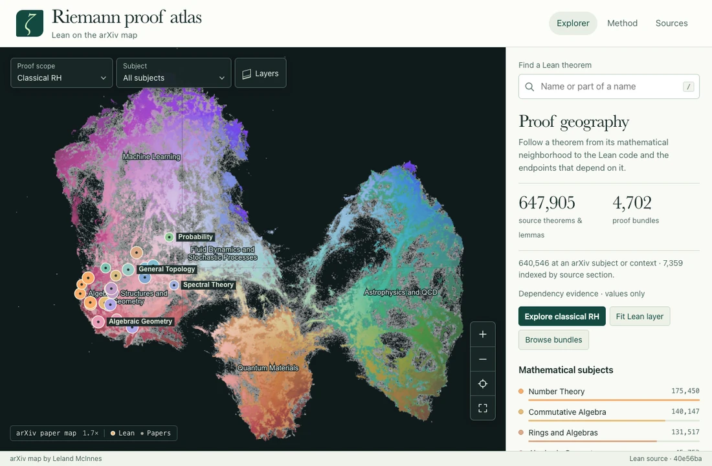

# Riemann proof atlas

Explore the written Lean theorems and lemmas of the Riemann hypothesis project on Leland McInnes’s map of arXiv papers. Select a subject or proof bundle, click a theorem, and follow **Open Lean source** to its original line. **Trace full graph path** explains how one of the five endpoint statements reaches the chosen theorem.

**[Explore the map](https://nasqret.github.io/riemann-proof-atlas/)** · [Rubinstein’s reading guide](https://nasqret.github.io/riemann-proof-atlas/rubinstein.html) · [Watch the 52-second tour](https://nasqret.github.io/riemann-proof-atlas/film/) · [Reading notes](https://nasqret.github.io/riemann-proof-atlas/notes.html) · [Public reading dashboard](https://nasqret.github.io/riemann-rev/) · [Original paper map](https://lmcinnes.github.io/datamapplot_examples/arXiv/)

**[Paper Sky](https://nasqret.github.io/riemann-proof-atlas/june-map.html)** · 3,080,258 paper rows, 28,977 named regions and a filter for 549,618 papers with a verified primary mathematics category. Select a proof marker to inspect its supporting paper and open the original Lean declarations.

**[Explore the Sernau compact GRH edition](https://nasqret.github.io/riemann-proof-atlas/?snapshot=72fead102f663d5c7a407964a13dc0cf9d977207&edition=grh-compact)** · [Read the four-page note](https://nasqret.github.io/riemann-rev/summary/grh-condensed-summary.pdf) · [Compare the source sizes](https://nasqret.github.io/riemann-proof-atlas/notes.html#sernau-compact)

The last stop on the proof evolution slider is the compact external rewriting, with 76,149 Lean code lines under its source root. The preceding stop opens its readable companion.

**[Explore the complete RH dependency graph](https://nasqret.github.io/riemann-proof-atlas/#graph=1&constant=14065054)** · [Inspect the original Lean source](https://nasqret.github.io/riemann-proof-atlas/june-map.html#written=1026737) · [Excluded foundations](https://nasqret.github.io/riemann-proof-atlas/june-map.html#foundation=1) · [Coverage and checks](https://nasqret.github.io/riemann-proof-atlas/data/time-map/placement-audit.json)

The map switch and snapshot slider open 30 pinned source editions on both paper backgrounds. Choose the daily history, the separate readable edition, prior captures or a pull request. Every command opens at its exact revision. [Latest Alpöge snapshot](https://nasqret.github.io/riemann-proof-atlas/?snapshot=d85ea673400d21f60655ea34fc57f5d16068c74a) · [Current readable edition](https://nasqret.github.io/riemann-proof-atlas/june-map.html?snapshot=dd2dcbe020d101dc603063ba5a7197b2c69600f1&track=readable)

Paper Sky uses 21 colors for named topic regions. The legend gives each region’s paper count and opens its place on the map. Two neutral colors distinguish other named topics from papers without a name at any of the nine levels.

The guide follows 521 citation stops in Michael O. Rubinstein’s 265-page working draft. Select a citation to see its position and open its exact Lean lines. The reader loads the author’s pinned version 2 and highlights each printed name on the PDF page. [Begin on page 61](https://nasqret.github.io/riemann-proof-atlas/rubinstein.html#page=61&cite=QH.thinH)

**[Daily snapshot dashboard](https://nasqret.github.io/riemann-proof-atlas/daily.html)** · [Official history](https://nasqret.github.io/riemann-proof-atlas/daily.html#track=official) · [PR #55 revisions](https://nasqret.github.io/riemann-proof-atlas/daily.html#track=proposal) · [VerifyTask and contributor changes](https://nasqret.github.io/riemann-proof-atlas/daily.html#track=verifytask) · [Daily capture runs](https://github.com/nasqret/riemann-proof-atlas/actions/workflows/atlas-daily.yml)

Use **Map removals** to find a declaration by mathematical subject and open its line in the earlier revision. Each date also indexes all changed modules and gives their before and after source links. UTC days close at midnight. The scheduled capture runs daily at 00:23 UTC and fills gaps left by missed runs. The website reads the current [data archive](https://github.com/nasqret/riemann-proof-atlas/tree/atlas-daily) and ships a local copy for offline use.

[Compare the source editions](https://nasqret.github.io/riemann-proof-atlas/editions.html) · [Read the tower-bound chapter](https://nasqret.github.io/riemann-proof-atlas/#chapter=1.5992) · [Open the note beside its Lean proofs](https://nasqret.github.io/riemann-proof-atlas/companion/index.html)

The edition map preserves the original coordinates for confidently matched declarations and links to the Lean source in each revision. The selector records the submission, merged simplifications and separately pinned proposals. In the tower-bound chapter, select a citation in the note to open its structured proof and the corresponding Lean lines. [Snapshot catalogue](https://nasqret.github.io/riemann-proof-atlas/data/editions/index.json) · [Upstream intake](https://github.com/nasqret/riemann-proof-atlas/blob/atlas-edition-intake/source-editions/intake.json)

[](https://nasqret.github.io/riemann-proof-atlas/)

The original theorem and lemma layer covers 818,755 written declarations, 4,983 proof bundles and 2,477,303 papers. Of the 818,755 declarations, 802,362 have a subject or contextual placement. Another 16,393 appear in 168 named source sections. Choose **Layers → Placement evidence** to isolate declarations and proofs or their surrounding mathematical context. [Inspect matrix addition](https://nasqret.github.io/riemann-proof-atlas/#theorem=10) · [Browse source sections](https://nasqret.github.io/riemann-proof-atlas/#subject=unresolved) · [Attribution evidence](https://nasqret.github.io/riemann-proof-atlas/data/refinement/index.json)

Select **ζ** to return to the original map. Zooming reveals more declarations while each existing marker keeps its geographic anchor. Use the four-corner icon or **F** for fullscreen. **Inspector** opens the theorem panel while the map stays in fullscreen. Use **/** to search, the arrow keys to pan, and **+** or **−** to zoom.

Serve this directory locally with Python and open [the local map](http://127.0.0.1:8000/).

```sh
python3 -m http.server 8000 --bind 127.0.0.1
```

With the explorer open, run the wheel, pinch and attribution checks in the browser console. The check opens three source declarations, zooms through both Lean layers and restores the opening view.

```js
await (await import("./qa/refinement-check.mjs")).checkRefinement()
```

The [file inventory](./SHA256SUMS) records the SHA-256 of every published payload file. The [Lean archive](https://github.com/leanprover-community/riemann-hypothesis/tree/40e56bab026552e089d7afcfeff08d2defb9c005/src) and [arXiv map revision](https://github.com/lmcinnes/datamapplot_examples/tree/551adb0d3c54a11eaec0d64874370f435b8cc195/arXiv) identify the original sources.

[Download the video walkthrough (MP4)](https://nasqret.github.io/riemann-proof-atlas/media/riemann-proof-atlas.mp4)
